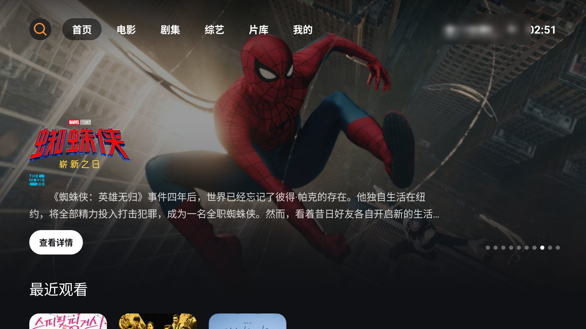
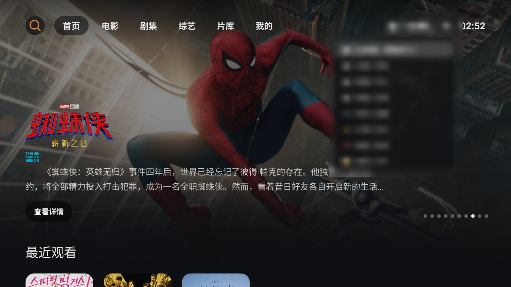
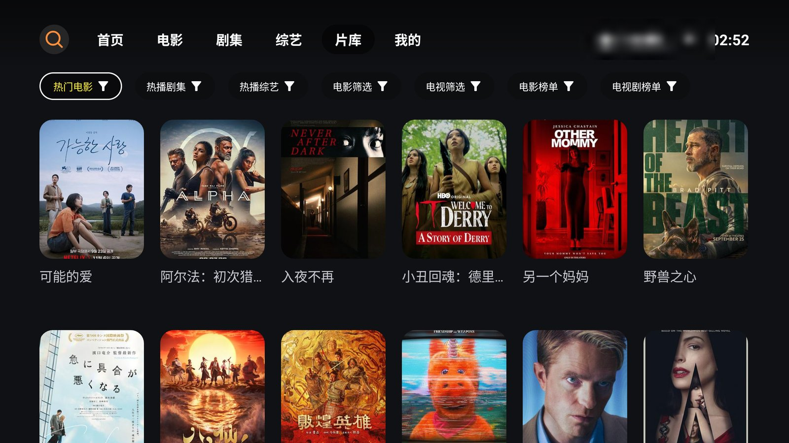
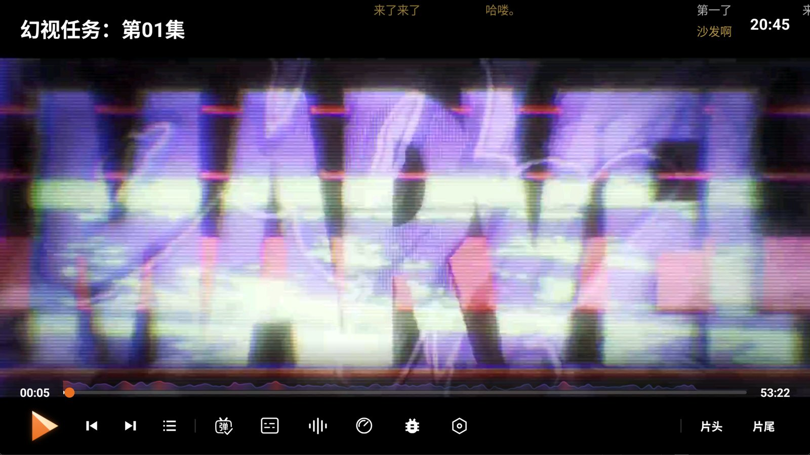

# NewTV2

基于 [FongMi/TV](https://github.com/FongMi/TV) 5.8.7 的深度定制分支，专注 **Android TV（leanback）** 形态：围绕影视点播重构了首页、片库、详情、播放与搜索体验，并接入自动化构建与自有更新源。

> **声明**：本应用不含、不集成、不提供、不存储任何影视资源；界面中的海报、剧照等素材仅用于信息展示。详见文末[免责声明](#免责声明)。

## 目录

- [特性总览](#特性总览)
- [品牌资产与启动画面](#品牌资产与启动画面)
- [首页 · 全新主视觉](#首页--全新主视觉)
- [共享顶栏与站源切换](#共享顶栏与站源切换)
- [片库 · 分类浏览](#片库--分类浏览)
- [海报卡片 · 统一视觉](#海报卡片--统一视觉)
- [播放器](#播放器)
- [搜索](#搜索)
- [详情页](#详情页)
- [相对上游的精简](#相对上游的精简)
- [构建与发布](#构建与发布)
- [致谢](#致谢)
- [免责声明](#免责声明)

## 特性总览

| 模块 | 相对上游的变化                                |
| -- | --------------------------------------- |
| 首页 | 全新主视觉：四平台热榜聚合 + TMDB 剧照轮播 + 元数据面板       |
| 顶栏 | 首页 / 片库共享顶栏，站源下拉切换，滚动自动显隐               |
| 片库 | 胶囊分类 + 三段式海报卡（海报 / 片名 / 元数据），站源就地切换不重建 |
| 播放 | 单一播放引擎；弹幕热力图进度条、弹幕搜索、片头 / 片尾跳过          |
| 搜索 | 三组聚合热搜 + 双平台联想词                         |
| 详情 | TMDB 元数据自动补全（评分 / 年份 / 类型 / 题材 / 简介）    |
| 构建 | 自动编译发布，测试包与正式包同签名，版本号含时间戳               |
| 更新 | 应用内更新源指向本项目发布页                          |

## 品牌资产与启动画面

整套视觉统一为：深色底 + 橙色斜切播放三角 + 「影视 Videos」字标。

- **启动画面**：直接展示品牌标志图，始终保持原始比例、屏幕水平垂直居中。屏幕与图片比例一致时正好铺满；屏幕更大时按原尺寸完整显示、四周以同色背景自然补齐；屏幕更小时等比缩小、不裁切。画面停留片刻后整体淡出，与首页内容无缝衔接。
- **TV 横幅**：桌面 / 启动器中的电视横幅同步换新，与整体视觉一致。
- **应用图标**：主图标与圆形图标套用同一套三角标识与深色底，各尺寸图标与商店展示图同步更新。

## 首页 · 全新主视觉

- **数据源**：爱奇艺 / 腾讯视频 / 优酷 / 芒果 TV 四平台热榜聚合，半小时缓存，切换数据源时自动失效。
- **剧照轮播**：横版剧照全屏铺底、底部羽化渐隐；约 7 秒自动轮播，左右键手动切换，指示点标识当前位置。
- **片名**：优先使用 TMDB 中文 Logo 原图，缺失时回退为文字。
- **元数据**：评分 · 年份 · 类型 · 题材 一行展示，无评分时自动隐藏评分标识。
- **简介**：首行缩进两字符，约占屏宽七成，默认常显。
- **查看详情**：一键直达结果页，不经过搜索页中转，也不会写入搜索历史。

## 共享顶栏与站源切换

首页与片库共用同一套顶栏，样式统一，一处调整两页同步生效：

- **左侧**：搜索按钮 + 6 个频道导航 —— 首页 / 电影 / 剧集 / 综艺 / 片库 / 我的（「我的」即设置入口）。
- **选中态**：聚焦项为白底橙字，当前所在页未聚焦时为半透明黑底橙字，其余为白字；搜索与站源图标同样使用品牌橙，聚焦时随底色反色。
- **右侧**：站源入口与时钟。
- **布局**：单行紧凑顶栏，左右留白统一，与下方内容保持同一条竖向基线。
- **站源下拉**：面板宽度随站源名称自适应，最多展示 8 项，带展开动画，右缘与入口按钮对齐。
- **自动显隐**：内容区下滑时顶栏自动隐藏，回到顶部或焦点上移时重新出现。

## 片库 · 分类浏览

- **胶囊分类**：热播电影 / 热播剧集 / 热播综艺 / 电影筛选 / 电视筛选 / 电影榜单 / 电视剧榜单。
- **站源切换**：在当前页就地完成，不闪烁、不重建页面，也不打断浏览位置。
- **切页方式**：仅顶部分类胶囊支持左右切换；焦点移到海报网格边缘后继续按方向键不再误触切页。
- **返回逻辑**：返回键先回到分类胶囊，向下可回到原来的海报位置。
- **尺寸联动**：在设置中调整海报尺寸后返回，片库会按新尺寸自动刷新，无需重新进入。

## 海报卡片 · 统一视觉

首页 / 片库 / 收藏 / 历史 / 搜索结果共用同一套海报组件（参考 JetStream 风格，适配本项目深色 + 橙色点缀）：

- **结构**：海报图 → 片名独立行 → 元数据行，三段式垂直排列；片名与角标不再压在海报图上，信息层次更清晰。
- **尺寸**：按屏幕安全区与列数自适应，整行恰好落在左右基线内。设置中的 小 / 中 / 大 / 特大 四档对应 7 / 6 / 5 / 4 列，浏览密度随手可调。
- **选中态**：聚焦时以白色描边勾出海报边界（不框住文字），过渡柔和；矩形、圆形、列表等各类卡片样式统一。
- **动效**：聚焦轻微放大并衬托阴影，切换焦点干净利落；快速连续走位也不会出现抖动或残影。
- **片名**：单行显示、尾部省略，默认浅灰、聚焦变白；仅当文字过长被截断时才滚动展示，短标题保持静止。
- **元数据**：年份 / 备注 / 站源信息，网格卡在聚焦时展开，收藏与历史页常显。

## 播放器

- **单一播放引擎**：只保留一套播放内核，含解码器预热等加载优化，包体更小、维护面更窄。
- **弹幕**：
  - 进度条叠加**弹幕热力图**，全片弹幕密度一目了然；
  - 弹幕搜索面板：按片名 / 集数换源匹配弹幕库；
  - 独立弹幕设置面板：样式、速度、屏蔽等可调。
- **片头 / 片尾快捷跳过**：控制栏直接操作，片尾判定已修正，到点即触发。
- **控制栏**：整体对齐重排，遥控器焦点走位顺畅一致。

## 搜索

- **聚合热搜**：三组热搜榜与首页主视觉共用同一数据源，12 小时缓存，过期缓存自动强刷。
- **联想词**：两个平台并发联想，过期结果按序丢弃、自动去重后展示。
- **搜索历史**：仅在搜索页主动搜索时写入；经「查看详情」直达结果页的关键词不会污染历史。

## 详情页

- TMDB 元数据自动补全：评分 / 年份 / 类型 / 题材 / 简介；多结果时优先精确匹配片名。
- 片名优先使用 TMDB 中文 Logo 原分辨率图。
- 底部剧照背景已停用，信息行更紧凑；剧照能力保留，继续服务首页主视觉。

## 相对上游的精简

| 移除项       | 说明                     |
| --------- | ---------------------- |
| 直播        | 整个直播体系移除，只保留点播         |
| 第二播放内核    | 统一单一播放引擎，减少包体与维护面      |
| 壁纸 / 双字幕  | 功能裁剪                   |
| mobile 形态 | 代码保留但不再编译适配，仅维护 TV 形态  |

产物仅提供 `arm64-v8a` 与 `armeabi-v7a` 两种架构的 TV 版本。

## 构建与发布

- **自动构建**：推送主分支即自动编译并发布，无需本地打包。
- **双架构产物**：每次发布同时提供 64 位与 32 位安装包，覆盖主流电视芯片。
- **版本号**：以内置版本为前缀，附加日期与时间戳，便于区分构建批次。
- **更新通道**：应用内检查更新直接读取本项目发布页，安装包命名与更新逻辑保持一致。

## 致谢

- 上游项目：[FongMi/TV](https://github.com/FongMi/TV) —— 本仓库所有基础能力（浏览、播放、投屏、互通、爬虫生态）均源于此。
- 爬虫开发参考：[CatVodSpider](https://github.com/FongMi/CatVodSpider)（Java / Python / QuickJS 範例）。
- 影视元数据：[TMDB](https://www.themoviedb.org/)。
- 海报视觉参考：[wobuhui666/TV](https://github.com/wobuhui666/TV) 的 JetStream 风格。

> 本项目仅供学习交流，请勿用于商业用途。

## 免责声明

1. **不含任何影视资源**：本项目（下称"本应用"）是一款开源播放器客户端。本应用本身**不包含、不集成、不提供、不存储、不分发任何影视资源**（包括但不限于电影、电视剧、综艺、动漫等视频文件、音频、字幕，以及其直链、种子或下载地址）。

2. **内容来自用户自行配置的第三方接口**：本应用中呈现的一切可播放内容，均来自使用者自行添加的第三方站点接口（爬虫规则）所返回的数据，其合法性、准确性、完整性均与本应用无关。使用者应自行确保其配置与使用行为符合所在地区法律法规，由此产生的一切法律责任由使用者自行承担。

3. **展示素材仅作信息介绍**：应用界面中展示的海报、剧照、片名 Logo 等图片素材，来自公开的影视资料接口（如 TMDB），**仅用于内容识别与信息介绍，不涉及任何影视资源的存储、分发或播放**；相关素材的著作权归其原始权利人所有。

4. **仅供学习交流**：本项目仅供个人学习、研究与技术交流使用，严禁用于任何商业用途。

5. **侵权请联系删除**：若本项目（包括文档、截图及界面中展示的素材）侵害了您的合法权益，请通过 [GitHub Issues](https://github.com/ctowl2018/NewTV2/issues) 联系我们并提供权属证明，经核实后我们将立即删除相关内容。

6. **责任限制**：本项目按"现状"提供，不对内容的合法性、准确性、完整性作任何明示或默示的保证。下载、安装或使用本项目即视为已阅读、理解并同意本声明全部条款。
